# Aryan Jaiswal

**Forward Deployed Engineer at Exotel · Voice AI, agentic systems & backend engineering**

I build AI systems from the first customer conversation through integration, evaluation and production. Based in Bangalore; B.Tech in Computer Science from IIIT Dharwad, class of 2026.

[Projects](#selected-projects) · [Portfolio](https://aryanjaiswal.in) · [LinkedIn](https://www.linkedin.com/in/aryanjstar/) · [Resume](assets/Aryan_Jaiswal_Resume.pdf) · [Email](mailto:aryanjstar3@gmail.com)

## What I build at Exotel

**Forward Deployed Engineer · Jun 2026–present** 
Previously **Tech Intern, GenAI · Oct 2025–Jun 2026**

- **Production voice AI:** shipped 7 voice agents across 5 languages, with work spanning customer requirements, prompts, tools, knowledge bases, integrations and go-live.
- **Argus:** built a voicebot debugging and evaluation platform with a Google Chat interface, Gemini tool calling and latency analysis; reduced call triage from roughly 30 minutes to under a minute.
- **AutoLoop, within Argus:** built a seven-stage workflow in an agentic harness with linked bot repositories and 16 agent skills. It generates scenarios, compares prompt techniques, selects winners and rolls back regressions. Argus/AutoLoop work with AI coding tools including Cursor and Claude Code; I also built its in-house voice simulator for **chat simulations → voice simulations → real-call validation**.
- **Campaign automation:** processed 100K lead entries across 10 Kinetic Green campaigns with Python, Jenkins and AWS, including post-call lead reports and deterministic campaign PDFs.
- **Backend integrations:** migrated Bawa's booking agent across 6 hotels, with HMAC-signed Camel routes, 313/313 route checks and 114/114 booking checks on staging before production cutover.

Earlier engineering experience

- **Exotel internship:** LangGraph runtime guards under DRI responsibility for 150K+ calls/month; NGINX WebSocket workers; Prometheus/Grafana monitoring; Ansible provisioning; and a FastAPI/Redis/React test framework.
- **Joveo — AI/ML Intern, Oct 2025:** email-processing and enterprise-search automation with n8n, embeddings and PostgreSQL/pgvector.
- **InfoKalash — UI/UX Developer Intern, Jan 2025:** user research, Figma workflows, reusable components and developer handoffs.
- **Infosys Springboard — AI/ML Intern, Mar–Jun 2024:** CNN plant-disease classification and Flask model serving.

## Selected projects

**[AURA — Agentic Finance AI](https://github.com/Aryanjstar/AURA---THE-FINANCE-AI)** 
Five-agent finance advisor with adaptive orchestration, six tools over MCP and streamed responses. **Google Cloud Agentic AI Day finalist**, top 3.5% of 57,000+ participants. 
`Node.js` `Azure OpenAI` `MCP` `Socket.IO` · [Demo](https://www.youtube.com/watch?v=3q4uTliRNr8)

**[The Wedding Home — Event Planning Platform](https://github.com/Aryanjstar/the-wedding-home)** 
Indian wedding planning with family workspaces, per-function guest lists, no-login RSVPs and a QR media gallery. API validation, Vitest and a Playwright journey are part of its delivery workflow. 
`Next.js` `TypeScript` `MongoDB` `Vercel` · [Live](https://the-wedding-home.vercel.app)

**[Myriox — Accessibility Floor-Plan Simulator](https://github.com/Aryanjstar/Myriox_v2)** 
LLM persona agents explore floor plans under deterministic mobility constraints; findings reference ADA clauses through vector search. Three FastAPI services and an MCP interface for saved plans. 
`FastAPI` `Next.js` `Azure OpenAI` `Cosmos DB` · [Demo](https://www.youtube.com/watch?v=IfA1XU-qBrU)

**[AI Career Navigator](https://github.com/Aryanjstar/AI-Career-Navigator)** 
Resume feedback, skill-gap analysis and interview preparation using Azure OpenAI and retrieval. **Overall Winner & People's Choice, Microsoft JS AI Build-a-thon.** 
`Python` `TypeScript` `Azure OpenAI` `Azure AI Search` · [Microsoft feature](https://techcommunity.microsoft.com/blog/educatordeveloperblog/ai-career-navigator-%E2%80%94-empowering-job-seekers-with-azure-openai/4459774)

**Also exploring:** [LEELA](https://github.com/Aryanjstar/LEELA), a studio that turns ideas, notes and code into narrated short films with timed speech, HyperFrames and FFmpeg. More work: [Cognitive-OS](https://github.com/Aryanjstar/Cognitive-OS) · [DevTinder](https://github.com/Aryanjstar/DevTinder).

## Research & community

- **COMSNETS 2026:** co-authored *A Bid-Driven Optimization Framework for Real-Time Electric Vehicle Charging Scheduling*. [Paper](https://doi.org/10.1109/COMSNETS67989.2026.11418229)
- **[Gold Microsoft Student Ambassador](https://techcommunity.microsoft.com/blog/studentdeveloperblog/meet-aryan-jaiswal/4538102):** founded the [IIIT Dharwad chapter](https://msa-iiitdwd.vercel.app), a community of 500+ members; mentored 80+ developers as a Build-a-thon Troop Lead.
- **Problem solving:** [GeeksforGeeks institute rank 2 at IIIT Dharwad](https://www.geeksforgeeks.org/profile/aryanjstar) and [800+ LeetCode problems](https://leetcode.com/u/aryanjstar/).
- **Credentials:** [Azure AI Apps & Agents Developer Associate](https://learn.microsoft.com/en-us/users/aryanjstar/credentials/certification/azure-ai-apps-and-agents-developer-associate?tab=credentials-tab) · [GitHub Agentic AI Developer](https://learn.microsoft.com/api/credentials/share/en-us/Aryanjstar/D269D8B15535F5D1?sharingId=3E11B14851102961).

## Tools I work with

**Languages & apps:** Python, TypeScript, JavaScript, SQL, Java, C++, React, Next.js, FastAPI, Node.js 
**AI & data:** LangGraph, RAG, MCP, evals, Pipecat, PostgreSQL, MongoDB, Redis, OpenSearch 
**Cloud & delivery:** Azure, AWS, Docker, NGINX, Apache Camel, Jenkins, GitHub Actions, Prometheus, Grafana

## On GitHub

<picture>
  <source media="(prefers-color-scheme: dark)" srcset="assets/contributions-dark.svg">
  
</picture>

Outside code, I enjoy singing and mentoring developers. For conversations about AI engineering, backend systems or building something together, [say hello](mailto:aryanjstar3@gmail.com).
