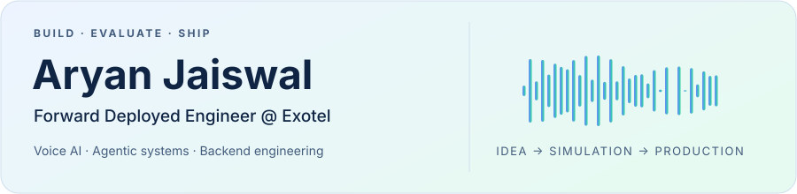

<picture>
  <source media="(prefers-color-scheme: dark)" srcset="assets/hero-dark.svg">
  
</picture>

  
  
  
  

### Hey, I'm Aryan 👋

I build AI systems from the first customer conversation through integration, evaluation and production. **Bangalore, India · IIIT Dharwad CSE, class of 2026.** Outside code, I sing and mentor developers.

**[Explore my projects ↓](#-selected-projects)** · [Research & community](#-research--community) · [The contribution snake](#-the-contribution-snake)

| 🎙️ Production voice AI | 🧠 Agentic engineering | ⚙️ Automation |
| :---: | :---: | :---: |
| **7 agents · 5 languages** | **Argus + AutoLoop** | **100K lead entries · 10 campaigns** |

## 🚀 What I build at Exotel

**Forward Deployed Engineer · Jun 2026–present** 
Previously **Tech Intern, GenAI · Oct 2025–Jun 2026**

- **Production voice AI:** shipped 7 voice agents across 5 languages, with work spanning customer requirements, prompts, tools, knowledge bases, integrations and go-live.
- **Argus:** built a voicebot debugging and evaluation platform with a Google Chat interface, Gemini tool calling and latency analysis; reduced call triage from roughly 30 minutes to under a minute.
- **AutoLoop, within Argus:** built a seven-stage workflow in an agentic harness with linked bot repositories and 16 agent skills. It generates scenarios, compares prompt techniques, selects winners and rolls back regressions. Argus/AutoLoop work with AI coding tools including Cursor and Claude Code; I also built its in-house voice simulator for **chat simulations → voice simulations → real-call validation**.
- **Campaign automation:** processed 100K lead entries across 10 Kinetic Green campaigns with Python, Jenkins and AWS, including post-call lead reports and deterministic campaign PDFs.
- **Backend integrations:** migrated Bawa's booking agent across 6 hotels, with HMAC-signed Camel routes, 313/313 route checks and 114/114 booking checks on staging before production cutover.

Earlier engineering experience

- **Exotel internship:** LangGraph runtime guards under DRI responsibility for 150K+ calls/month; NGINX WebSocket workers; Prometheus/Grafana monitoring; Ansible provisioning; and a FastAPI/Redis/React test framework.
- **Joveo — AI/ML Intern, Oct 2025:** email-processing and enterprise-search automation with n8n, embeddings and PostgreSQL/pgvector.
- **InfoKalash — UI/UX Developer Intern, Jan 2025:** user research, Figma workflows, reusable components and developer handoffs.
- **Infosys Springboard — AI/ML Intern, Mar–Jun 2024:** CNN plant-disease classification and Flask model serving.

## 🧩 Selected projects

<table>
<tr>
<td width="50%" valign="top">
<h3>💸 AURA</h3>

Five-agent finance advisor with adaptive orchestration, MCP tools and streamed responses.

<strong>Google Cloud Agentic AI Day finalist</strong> — top 3.5% of 57,000+ participants.

<code>Node.js</code> <code>Azure OpenAI</code> <code>MCP</code>

<a href="https://github.com/Aryanjstar/AURA---THE-FINANCE-AI">Code ↗</a> · <a href="https://www.youtube.com/watch?v=3q4uTliRNr8">Watch demo</a>
</td>
<td width="50%" valign="top">
<h3>💍 The Wedding Home</h3>

A shared workspace for Indian weddings: family roles, per-function guests, no-login RSVPs and a QR media gallery.

Validated APIs, Vitest suites and a Playwright journey.

<code>Next.js</code> <code>TypeScript</code> <code>MongoDB</code>

<a href="https://github.com/Aryanjstar/the-wedding-home">Code ↗</a> · <a href="https://the-wedding-home.vercel.app">Try it live</a>
</td>
</tr>
<tr>
<td width="50%" valign="top">
<h3>♿ Myriox</h3>

Accessibility simulation with LLM personas, deterministic mobility constraints and findings grounded in ADA clauses.

Three FastAPI services; saved plans accessible through MCP.

<code>FastAPI</code> <code>Azure OpenAI</code> <code>Cosmos DB</code>

<a href="https://github.com/Aryanjstar/Myriox_v2">Code ↗</a> · <a href="https://www.youtube.com/watch?v=IfA1XU-qBrU">Watch demo</a>
</td>
<td width="50%" valign="top">
<h3>🧭 AI Career Navigator</h3>

Resume feedback, skill-gap analysis and interview preparation with Azure OpenAI and retrieval.

<strong>Overall Winner &amp; People's Choice</strong> — Microsoft JS AI Build-a-thon.

<code>Python</code> <code>TypeScript</code> <code>Azure AI Search</code>

<a href="https://github.com/Aryanjstar/AI-Career-Navigator">Code ↗</a> · <a href="https://techcommunity.microsoft.com/blog/educatordeveloperblog/ai-career-navigator-%E2%80%94-empowering-job-seekers-with-azure-openai/4459774">Microsoft feature</a>
</td>
</tr>
</table>

**Also exploring:** [LEELA](https://github.com/Aryanjstar/LEELA), a studio that turns ideas, notes and code into narrated short films with timed speech, HyperFrames and FFmpeg. More work: [Cognitive-OS](https://github.com/Aryanjstar/Cognitive-OS) · [DevTinder](https://github.com/Aryanjstar/DevTinder).

## 🏆 Research & community

- **COMSNETS 2026:** co-authored *A Bid-Driven Optimization Framework for Real-Time Electric Vehicle Charging Scheduling*. [Paper](https://doi.org/10.1109/COMSNETS67989.2026.11418229)
- **[Gold Microsoft Student Ambassador](https://techcommunity.microsoft.com/blog/studentdeveloperblog/meet-aryan-jaiswal/4538102):** founded the [IIIT Dharwad chapter](https://msa-iiitdwd.vercel.app), a community of 500+ members; mentored 80+ developers as a Build-a-thon Troop Lead.
- **Problem solving:** [GeeksforGeeks institute rank 2 at IIIT Dharwad](https://www.geeksforgeeks.org/profile/aryanjstar) and [800+ LeetCode problems](https://leetcode.com/u/aryanjstar/).
- **Credentials:** [Azure AI Apps & Agents Developer Associate](https://learn.microsoft.com/en-us/users/aryanjstar/credentials/certification/azure-ai-apps-and-agents-developer-associate?tab=credentials-tab) · [GitHub Agentic AI Developer](https://learn.microsoft.com/api/credentials/share/en-us/Aryanjstar/D269D8B15535F5D1?sharingId=3E11B14851102961).

## 🛠️ Tools I work with

  
  
  
  
  
  
  
  
  
  
  
  

**Also in my toolkit:** Java, C++, SQL, MongoDB, OpenSearch, RAG, Pipecat, AWS, NGINX, Apache Camel, Jenkins, Prometheus and Grafana.

## 🐍 The contribution snake

<picture>
  <source media="(prefers-reduced-motion: reduce) and (prefers-color-scheme: dark)" srcset="assets/contributions-dark.svg">
  <source media="(prefers-reduced-motion: reduce)" srcset="assets/contributions-light.svg">
  <source media="(prefers-color-scheme: dark)" srcset="assets/github-snake-dark.svg">
  
</picture>

## 🏙️ A year in contributions

<picture>
  <source media="(prefers-color-scheme: dark)" srcset="assets/skyline-dark.svg">
  
</picture>

See the animated contribution grid

<picture>
  <source media="(prefers-color-scheme: dark)" srcset="assets/contributions-dark.svg">
  
</picture>

Real GitHub data · refreshed daily · light &amp; dark themes

---

Building something in AI, backend systems or developer tools? <strong><a href="mailto:aryanjstar3@gmail.com">Let's talk.</a></strong>

